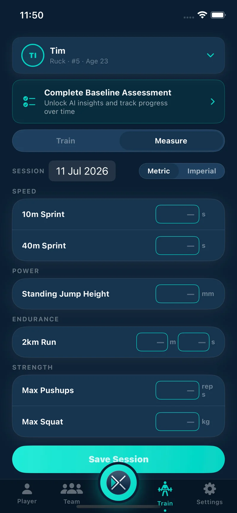

# WP-1 hand-off: shared components, navigation, contact email

Branch: `wp-1-foundation` (from `claude/zealous-rubin-a0gycr`).

## Files changed
- `_includes/site-header.html`: "Train" link (`/train.html`) between Coaches and Sports; `active="train"` supported (doc comment updated).
- `_includes/site-footer.html`: "Train" added first in the Product list.
- `sports/{afl,basketball,field-hockey,football,netball,rugby-league,rugby-union,soccer}/index.html`: Train added to header nav and footer Product list only.
- `match/index.html`: Train added to header nav and footer Product list only (this page's nav is Features / Sports / Pricing / How It Works, so Train follows Features).
- `css/components.css`: appended `.x-tier`, `.x-pillars`, `.x-shot` (commented block at the end).
- `images/icons/score.svg`, `track.svg`, `train.svg` (new): 48x48 turquoise stroke icons.
- `documentation/components-demo.html` (new; `documentation/` is excluded from the Jekyll build).
- `documentation/handoff/screens/wp-1/*.png` (new).

Not changed (no nav or footer block to edit): `404.html` and `go/index.html` (redirect scripts), `card/index.html` (app bar only), `blog/index.html` (uses the default layout, so it gets the include). `_config.yml` and `css/tokens.css` untouched.

## Contact email (D5)
`grep -rn "support@scorx"` over the built site: no matches. `scorxapp@gmail.com` stays everywhere. Hard-coded `mailto:scorxapp@gmail.com` occurrences remain in the footers of `sports/*/index.html` (2 each) and `match/index.html` (2); the include uses `site.contact_email`. No changes needed by WP-2 for email.

## Components
Pages need `tokens.css` + `components.css` (as `index.html` does). In blog posts wrap in `.x-scope`. Full copyable markup: `documentation/components-demo.html`.

### Tier chip
```html
<span class="x-tier x-tier--free">Free</span>
<span class="x-tier x-tier--premium">Premium</span>
```
Free: tinted pill, ink `#00675C` on `#DDF4F1` (light), `#1FEDD8` on translucent turquoise (dark). Premium: turquoise gradient, navy text. Both pass AA. Uses new vars `--x-free-bg/-ink/-line`.

### Pillars
```html
<div class="x-pillars">
  <article class="x-pillar">
    <div class="x-pillar__icon"></div>
    <h3 class="x-pillar__title">Score</h3>
    <p class="x-pillar__tag">Score it</p>
    <ul class="x-pillar__list"><li>...</li><li>...</li><li>...</li></ul>
    <a class="x-pillar__link" href="/features.html#score">See scoring</a>
  </article>
  <!-- Track (track.svg, /features.html#track), Train (train.svg, /train.html) -->
</div>
```
Three columns from 768px, stacked below. Icon sits on a navy tile so the turquoise stroke reads in both themes.

### Screenshot
```html
<figure class="x-shot x-shot--phone">   <!-- or x-shot--ipad -->
  <div class="x-shot__frame">
    
  </div>
  <figcaption class="x-shot__cap">Caption</figcaption>
</figure>
```
Missing image slot:
```html
<figure class="x-shot x-shot--phone">
  <!-- ASSET NEEDED: description, device, size, format -->
  <div class="x-shot__slot">Screenshot coming soon</div>
  <figcaption class="x-shot__cap">Caption</figcaption>
</figure>
```
Phone max width 280px, iPad 420px; always give real width/height.

## Verification
- Jekyll 4.4.1 installed and built the site (`jekyll build`); every built page's nav contains `train.html` except `404.html`, `card/index.html`, `go/index.html` (no nav).
- Playwright, deviceScaleFactor 1, 375/768/1280. No horizontal scroll on home, sports/afl, match or the demo at any width (scrollWidth equals viewport). At 375px the menu opens and Train is visible and tappable (60px high); the open menu fits within the viewport. Nav is a hamburger up to at least 768px; at 1280px all eight items fit on one line.
- Screenshots in `documentation/handoff/screens/wp-1/`: `home-{375-closed,375-menu-open,768,1280}.png`, `sports-afl-*`, `match-*`, `components-demo-{375,768,1280}-{light,dark}.png`.

## Open items
- `/train.html` doesn't exist yet (WP-3); links 404 until it lands.
- Hard-coded sports/match navs don't include "Make a card" (they didn't before); I only added Train. WP-9 may want to align them.
- `match/index.html` footer still says "2025 Twine App Dev" and its footer has no Athletes/Coaches links; out of WP-1 scope.
- Tier chip on pages without tokens.css (style.css-only pages) falls back to light values; WP-2 and later should load tokens.css + components.css if they use the chips, or wrap in `.x-scope`.
